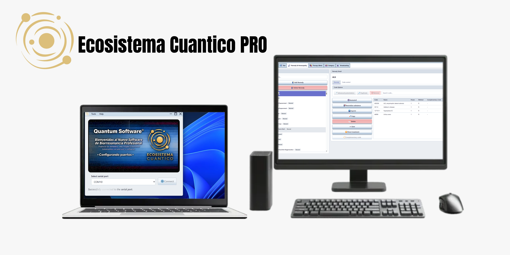

# Ecosistema Cuantico PRO

[![GitHub Release][release-image]][release-url]
[![GitHub Stars][stars-image]][stars-url]
[![GitHub Downloads][downloads-image]][release-url]

> Modern software for homeopathic medicine and alternative medicine management.

## Overview

**Ecosistema Cuantico PRO** is commercial desktop software designed to simplify the management of homeopathic remedies, patient information, analyses, and distance-based treatments.

With a modern and intuitive interface, the application provides tools to help users manage their information and workflows efficiently.

## Features

- **Remedy Management:** Organize and manage homeopathic remedies.
- **Patient Management:** Maintain patient information.
- **Analysis Tools:** Access tools for performing and managing analyses.
- **Distance Treatments:** Manage distance-based treatment sessions.
- **Modern User Interface:** Enjoy a clean and intuitive desktop experience.
- **Automatic Updates:** Receive application updates and improvements when available.

## System Requirements

The following are the intended system requirements for running Ecosistema Cuantico PRO.

| Component | Requirement |
|---|---|
| Operating System | Windows 10 or Windows 11 |
| Architecture | x64 (64-bit) |
| RAM | 8 GB minimum; 16 GB recommended |
| Storage | 250 GB available disk capacity |

**Note:** The storage requirement should be verified against the application's actual installation and data needs before publication.

## Installation

1. Visit the [Latest Releases][release-url] page.
2. Download the appropriate installer from the available release assets.
3. Run the installer and follow the on-screen instructions.
4. Launch Ecosistema Cuantico PRO once the installation is complete.

### Download

Get the latest version from the official GitHub releases page:

**[Download Ecosistema Cuantico PRO][release-url]**

Make sure to download the installer file provided in the selected release.

## Updates

Ecosistema Cuantico PRO supports automatic updates to help users receive new releases, bug fixes, and improvements when updates are published.

## Support and Feedback

If you encounter a problem or have a suggestion, please report it through the repository's GitHub Issues section, if enabled.

Your feedback helps improve the application.

## Disclaimer

Ecosistema Cuantico PRO is intended for managing homeopathic information and related workflows. It is not a substitute for professional medical advice, diagnosis, or treatment.

---

[release-image]: https://img.shields.io/github/v/release/HMNCdeveloper/Ecosistema_Cuantico-PRO
[release-url]: https://github.com/HMNCdeveloper/Ecosistema_Cuantico-PRO/releases
[stars-image]: https://img.shields.io/github/stars/HMNCdeveloper/Ecosistema_Cuantico-PRO
[stars-url]: https://github.com/HMNCdeveloper/HMNCdeveloper/Ecosistema_Cuantico-PRO/stargazers
[downloads-image]: https://img.shields.io/github/downloads/HMNCdeveloper/Ecosistema_Cuantico-PRO/total

